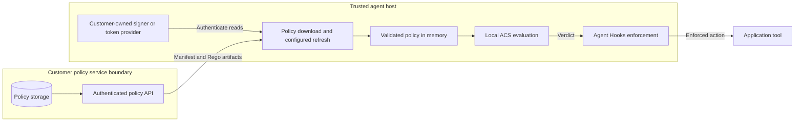

# Remote policy download contract v1

This is an optional Python package that has not been released yet. Install
`agent-control-spec-remote-policy` separately from the base SDK; its import
namespace is `agent_control_spec_remote_policy`. This is a new provider-neutral
distribution contract, not an existing cloud provider's management API.
Policy creation, updates, inheritance, authorization, and storage remain the
backend's responsibility. The SDK only downloads complete artifacts and caches
them **in memory**, independently for each configured agent.

## High-level architecture



The API owns storage and read authorization; the SDK downloads artifacts, not
remote decisions. Authentication is pluggable and does not give policy content
permission to change credentials or execute tools. Local YAML/Rego bypasses
remote downloading and authentication while retaining local ACS evaluation and
host enforcement. See the
[source-switching guide](../sdk/remote-policy/python/README.md#customer-owned-signer-azure-and-switching-back-to-local-files).

## Configuration and lifecycle

The lifecycle decision is that `ActivatedPolicy.activate(path)` stays synchronous
and never touches the network, and that readiness moves to the asynchronous
context entry. A synchronous `activate()` therefore cannot return a policy whose
first snapshot already exists. The host learns that the policy is ready when
`async with AsyncAcsInterceptor(policy)` returns, and evaluation before then
raises `ManagedPolicyUsageError`. The alternative, an asynchronous `activate()`
for remote files only, would give local and remote policies different call shapes
and end the path-only switch back to a local manifest.

Use `ActivatedPolicy.activate(path)` then `async with AsyncAcsInterceptor(policy)`
for either local ACS or remote-policy YAML. Remote activation captures validated
configuration synchronously, without network work. Async entry opens configured
credentials, fetches every required initial snapshot, and starts the default
HTTP source/`PolicyPoller`. The stable managed handle holds atomic immutable
in-memory revisions, not a replaceable native `_handle`.

Remote evaluation runs in the existing credential-free local worker. A
snapshot-bound completion carries the full native `Verdict` and a synchronous
currentness assertion to the outer interceptor after its **last internal await**.
A later emitter/application await is outside this guarantee: re-evaluate when
execution is deferred or another interceptor awaits afterwards.
`RemotePolicyClient.open(path)` and its full-verdict `evaluate` remain supported.
The v1 artifact contract/restricted ACS profile below are unchanged.

Remote activation is single-owner/single-use. Call `activate()` again for a new
lifetime; use separate loaders/registries for concurrent lifetimes. There is one
process-wide evaluation slot and no queue, unlike local mode's default
concurrency of 8. Every overlapping call, for another agent or another
interceptor, is denied with `runtime_error:acs_async_capacity_exceeded`, and the
warning log names the agent. Each evaluation starts a fresh isolated child
process: on a Linux developer laptop with the sample policy the median was about
0.29 seconds, so the ceiling is roughly 3 to 4 evaluations per second per
process. Measure your own host and policy. Before READY, evaluation
raises `ManagedPolicyUsageError`; close returns closed denials, including pending
calls unless their caller requested cancellation. Remote synchronous evaluation/
introspection and incompatible local overrides raise clear usage errors.
Loader async contexts enter/exit in the same owned task and must close before
the owner loop. Failed cleanup is reported, not treated as successful cancellation.
Closing during startup raises `ManagedPolicyUsageError("Remote startup was closed")`
unless the entry caller itself requested cancellation. The managed outer startup
wait is 240 seconds; close waits up to 30 seconds for the loader owner. These
fixed limits are independent of inner YAML/credential budgets and can expire
while legal cleanup remains active. Exhaustion raises `ManagedPolicyUsageError`,
not proof that work stopped: retain the owner loop until actual drain. Repeated
`aclose()` calls reuse owned cleanup and replay recorded failures, including
failed-start errors, rather than silently swallowing them.

```yaml
remote_policy:
  endpoint: https://policies.example.net
  credential_ref: policy-reader
  poll_interval_seconds: 300
  request_timeout_seconds: 10
  agents:
    - agent_id: agent-1
      tenant_id: tenant-1
      policy_id: policy-1
    - agent_id: agent-2
      tenant_id: tenant-1
      policy_id: policy-2
```

`tenant_id` and `policy_id` are flat, opaque backend selectors. The SDK does not
interpret them as cloud resource paths or logical policy keys inside an ACS
manifest. There is one selection per agent in v1; up to 32 agents, including
agents sharing a selection.
Shared selections have independent cache state and are not coalesced.

`PollerConfig.from_yaml` accepts only the `remote_policy` root. Backend-specific
configuration belongs to the host's `PolicySource`, not the SDK schema.
No source implementation is imported or selected by the core from YAML.
Reusable example YAML files contain only generic `remote_policy` settings;
deployment values belong in private host configuration. Logical artifact
keys come from the downloaded manifest and cannot be renamed independently of
its pinned bytes. The generic HTTP path needs no local Rego-key mapping.

IDs must match `[A-Za-z0-9][A-Za-z0-9_.-]{0,127}`. YAML IDs are strings, without
coercion; quote names such as `"no"` or `"010"`. Unknown fields, duplicates,
anchors, aliases, tags, merge keys and multiple documents are rejected. YAML
is capped at 64 KiB, 32 levels and 10,000 events. YAML intervals are 5-3,600
seconds; an explicit constructor override may be shorter for tests. Timeouts
are positive, at most 120 seconds, and below the interval.

- `PolicyPoller(config, source)` has no background work until `await start()`.
- Startup downloads **all** required agents or raises `StartupError` and closes.
- Refreshes run at a fixed rate (**300-second default**), skipping missed periods,
  plus extra refreshes as a lease nears its end ([freshness](#freshness-failures-and-ownership)).
- `await refresh(agent_id)` forces a shared, single-flight refresh.
- `get_policy(agent_id)` returns a current immutable `PolicySnapshot`, or raises
  `PolicyUnavailable`. `bundles()` returns a fresh copy, not mutable cache data.
- `status(agent_id)` exposes revision, state, last success and a safe error kind.
- After actual local evaluation, call `assert_current(agent_id, snapshot)`
  **immediately before the effect**, without an intervening await.
- Use `async with` or `await aclose()`. APIs are loop-affine and single-use.
  The poller owns/closes the supplied source; do not share it between pollers.

At most four source fetches run concurrently. Each agent's request timeout
includes waiting for a fetch slot, credential acquisition and I/O; it is not
a fresh timeout after admission. For startup, budget at least
`ceil(agent_count / 4) * slowest_fetch_seconds`, plus scheduling headroom.
Decoding is bounded by the artifact limits and runs synchronously on the event
loop. More agents or a slower backend may require increasing the default
10-second timeout, within the limits above.

The optional package accepts a host-supplied `PolicySource` with async
`fetch(selection: AgentPolicy, if_none_match: str | None) -> Changed | NotModified`
and `aclose()`. `Changed(body: bytes, etag: str)` preserves the exact wire bytes;
`NotModified(etag: str)` contains no new lease. A custom source need not use
HTTP or a particular cloud provider, but must export this complete ACS/Rego
envelope.
`endpoint` is optional; if present it must be an HTTP(S) URL without user-info,
query or fragment, even for custom sources.

`RemotePolicyFileLoader(source_factory=..., poller_factory=..., registry=...)`
can be injected through core `activate(..., remote_loader=loader)`.
`RemotePolicyClient.open` accepts the same source/poller factories. The source
factory receives validated config/read-only credentials; the poller factory
receives config/source and implements `PolicyPollerProtocol`. Factories are
trusted nonblocking host constructors. Custom pollers preserve the validation,
atomic revision, lease, fence, bound and source-close obligations above.
Credential providers/signers and the separate optional Azure adapter remain
independent of poller/source selection. YAML only selects registered provider
keys/options, never executable imports.

Managed integration uses capability 1 in both distributions and lazy optional
exports. Old-core/new-optional low-level imports remain supported; managed access
fails explicitly. New-core/old-optional valid remote activation raises
`RemotePolicyDependencyError`, while local activation remains available.
The polling package requires the core release it is published with, which is the
first release that carries capability 1. An older published core does not.
The release checklist is in [RELEASING.md](../RELEASING.md).

## HTTP request and response

```http
GET {endpoint}/v1/tenants/{tenant_id}/policies/{policy_id}
Authorization: <host-provided value>
Accept: application/json
Accept-Encoding: identity
X-Request-ID: <32 random hexadecimal characters>
If-None-Match: "<previous-sha256>"
```

The client sends a fresh `X-Request-ID` on every request so a request can be
found in service logs. It is correlation only: it carries no identity or
authorization, and the service must not trust or require it.

Send `If-None-Match` **only while an active, unexpired snapshot exists**. Recovery
after expiration or an authorization fence uses an unconditional GET.

`200` requires `Content-Type: application/json` (optional `charset=utf-8`) and a
strong `ETag` consisting of the quoted, lowercase SHA256 of the **exact response
bytes**. No compression or `Content-Encoding`, weak ETag, redirect, or delta.

| JSON field | Required meaning |
|---|---|
| `schema_version` | Integer `1` |
| `tenant_id`, `policy_id` | Exact requested selectors |
| `revision` | Monotonic integer, 1 through 2^63-1 |
| `issued_at`, `expires_at` | UTC `YYYY-MM-DDTHH:MM:SS[.ffffff]Z` |
| `manifest` | Complete ACS YAML string |
| `bundles` | Logical manifest Rego key -> `modules`, optional inline `data` |

The [golden envelope](../sdk/remote-policy/python/tests_remote_policy/fixtures/remote_policy_v1.json) is shared
by contract tests and the reference server. For example, `bundles.gate.modules`
maps a basename such as `limits.rego` to Rego source. Optional `data` is a list
of `{mount: ["logical", "path"], document: <JSON>}` objects, not filesystem paths.
The ACS Rego input uses the existing engine envelope: the example reads
`input.policy_target.value.amount`, not `input.amount`.

Reject duplicate/unknown JSON fields, bool revisions, NaN/Infinity, invalid
Unicode, and nesting beyond 32. Body limit: 1 MiB. Module limit: 64 total,
64 KiB each; basename IDs with `.rego` suffix, no separators. Passive admission
mirrors native authoring limits: nesting 12, 1,024 structural tokens, 262,144
depth-weighted byte units. Admission is **not** code compilation.

## Restricted ACS profile

The SDK validates the exact original manifest with the native parser, not a
re-serialized PyYAML interpretation. Allowed:

- supported `agent_control_specification_version`;
- opaque `metadata` (never interpreted as identity or logged);
- nonempty `policies` containing only `type: rego` and a rule-path `query`;
- nonempty `intervention_points`, simple `policy: {id, query?}` bindings,
  `policy_target`, `policy_target_kind`, and `tool_name_from`;
- optional tool declarations containing only `type: Tool` and `id`;
- complete embedded bundles for every declared logical Rego key.

Queries are ASCII paths such as `data.refund_limits.verdict`, at most 256
characters. No expression, indexing or call. Reject disk/URL bundles, adapter
`data`/`data_paths`, annotators, approvals, inheritance, custom/Cedar/test engines
and unknown binding fields. Native empty defaults for `extends`, `annotators`,
and point `annotations` are harmless and allowed; nonempty values are rejected.

A downloaded snapshot is not an activated or prepared policy. Do not feed
untrusted Rego into host in-process `ActivatedPolicy.from_memory`. Use a reviewed
isolation/evaluation adapter and fail closed on errors. The
[reference example](../examples/remote_policy/README.md) evaluates the actual
ACS engine in a bounded child process; it is not a production OS sandbox or a
high-throughput hot-swap interceptor.

## Freshness, failures and ownership

Lease duration must be at least `2 * interval + timeout`, at most 24 hours.
Recommend **15-minute leases**. Changing any bytes, including expiration,
requires a larger revision.

A `304` and an identical `200` never extend a lease: only a newer revision does.
The publish cadence is therefore a requirement of this contract, not a tuning
option. The service must issue each next revision, with a greater `revision` and
new `issued_at` and `expires_at`, no later than

```text
lease - 2 * poll_interval - request_timeout
```

after the previous one. With a 900-second lease, a 300-second interval and a
10-second timeout that is 290 seconds. Within that bound two fixed-rate polls
fall between the new revision and the old expiry, so one failed poll does not
fail the agent closed. A service that publishes every 600 seconds against that
900-second lease can fail every agent closed for up to 300 seconds after one
transient `5xx`; at 890 seconds it can miss the lease boundary with no error at
all.

The poller also refreshes early as a lease ends. Beginning `poll_interval +
request_timeout` before expiry it targets extra attempts for that agent at
halving distances. The last target is `request_timeout + 1 second` before
expiry, even if a slow earlier request left less than a full timeout. At the
defaults that is at most five extra attempts in the final 310 seconds. The times
are targets, not guarantees: attempts share one scheduler with the fixed-rate
poll, so a poll still running when an attempt falls due delays it until the poll
ends, and an attempt still running when a poll falls due delays the poll by up to
one request timeout. Slack under a microsecond counts as spent. A failed attempt
is retried while the snapshot is still valid, and any refresh that installs a
different snapshot replans the attempts at once, without delaying a poll or an
attempt that is already due. Extra attempts for one agent start at least one
`request_timeout` apart even across revisions, so a service that keeps
issuing newer revisions with nearly expired leases cannot make the poller hammer
it; an attempt that cannot keep that spacing and still start by the last target
is skipped, and the next fixed-rate poll decides. This absorbs a late or retried
publication. It does not replace the cadence above: a service that publishes
after the last attempt still leaves the agent failed closed until the first
fixed-rate poll after the publication.

`304` must echo the requested ETag and contain no body. It **never extends the
lease**. An identical `200` body and ETag skip repeat artifact decoding and
preserve active snapshot identity; an ETag match alone cannot hide changed bytes.
After a
fence it can reinstall identical still-valid artifacts. Lower revisions or
changed bytes at the same revision are rejected, even after eviction. A
delete/recreate at a lower revision needs an explicit trusted operator restart.

| Condition | SDK behavior |
|---|---|
| `401/403/404/410` | Fence that agent immediately; no automatic token retry |
| `429/5xx`, transport timeout | Surface error; retain only still-valid previous artifacts |
| Protocol violation: redirect, unexpected status, `Content-Encoding`, weak or missing `ETag`, wrong `Content-Type`, body over 1 MiB, or a `304` with a body | Surface a `PolicySourceError` of kind `protocol`; never follow, retry or decode the response; retain only still-valid previous artifacts |
| Malformed/scope-mismatched candidate | Reject candidate; never replace a valid snapshot |
| Expired, absent, changed-during-evaluation | Raise; host must not execute |
| Unexpected scheduler failure/cancellation | Fence access |
| Close/drain failure | Raise `PolicyCloseError`, not successful shutdown |

Revocation is visible on the next successful poll, or lease expiration under
partition, not instantly. The initial host UTC clock is **trusted**; synchronize
it. Future `issued_at` beyond 60 seconds is rejected, but aged documents cannot
prove clock synchronization. Monotonic deadlines prevent **later** wall-clock
rollback or unchanged-response replay from extending a captured lease.

At most four requests and one retained fetch per agent. Cancellation-resistant
custom sources retain their slot and cannot install late results or accumulate
retries. Close waits up to five seconds per drain phase, retains unfinished
references, and reports failure. Such sources must be repaired; they are not
treated as closed. Credentials remain caller-owned. SDK audit events contain
configured IDs, revision, ETag, absolute expiry, request ID and safe error kind.
INFO messages include those safe policy summaries for ordinary log formatters.
They never include token, response,
manifest, module, metadata, or evaluation context.

## Authentication and provider configuration

`credential_ref` resolves against a **host-owned** mapping of
providers. Existing injected `AuthorizationProvider.authorization() -> str`
objects remain supported. To construct a provider from trusted configuration,
declare it under `remote_policy.credentials`:

```yaml
credential_ref: policy-reader
credentials:
  policy-reader:
    provider: custom_platform
    options: {}
```

These fields belong inside `remote_policy`, alongside the endpoint and agents.
`CredentialProviderRegistry.open(config)` opens only the selected named factory
and supplies a read-only reference-to-provider mapping for
`HttpPolicySource.from_config`. Register `custom_platform` in trusted host code;
it is an example registry key, not a built-in provider. The registry is the
complete allow-list of trusted factories and is empty by default: a
`credential_ref` that names a provider the host did not register is refused
before any credential is acquired or request is sent. Unknown references/kinds
fail without fallback. YAML never names executable modules, commands or arbitrary
classes. See the [custom-provider example](../examples/remote_policy/README.md#custom-providers).

A registered factory is given the YAML's options, and the YAML chooses the
`endpoint` that receives the resulting credential. Whoever can write the YAML
therefore controls the token audience (the Azure CLI factory's `scope`) and the
destination the token is sent to, before any policy is fetched or checked.
Treat the file as trusted host configuration, never as user input.

Definitions and their scalar options are immutable, hidden from representations
and defensively copied. There are at most 32 definitions and 32 option keys per
definition; option JSON is at most 16 KiB within the existing 64 KiB YAML bound.
Nested objects/arrays and non-finite numbers are rejected in this v1 option
schema. No raw credential, password, private key or bearer token belongs in YAML.

For request-dependent authentication, implement
`RequestAuthenticator.authenticate(AuthenticationRequest) -> Mapping[str, str]`.
The frozen context contains the exact final normalized method, URL/query,
lower-case pre-auth headers and empty GET body. Return only new auth headers.
The shared HTTPX adapter supports `httpx.AsyncClient` with buffered requests
(the supplied sources use empty-body GETs). Synchronous clients and unread
streaming bodies fail closed. It authenticates once and yields once: it never conceals a
401 with an auth retry or lets a provider change the request destination.

Header names are RFC 9110 ASCII tokens, 1-128 bytes. At most 32 headers, each
value 1-16384 ASCII SP/VCHAR bytes with no leading/trailing whitespace, and at
most 32768 name/value bytes in total. CR/LF, tabs, other controls, non-ASCII values,
empty output and case-insensitive duplicates fail. Interior spaces support
multi-part request signatures. The single-header interface uses its
original stricter scheme/token validation.

Every existing pre-auth header is reserved, even if returned unchanged.
Additionally forbidden: `Host`, `Connection`, `Keep-Alive`, `content-*`,
`Transfer-Encoding`, `TE`, `Trailer`, `Upgrade`, `Expect`, `proxy-*`, `Cookie`,
`Set-Cookie`, `Forwarded`, `x-forwarded-*`, `Via`, `Max-Forwards`, `Range`, `if-*`,
`X-HTTP-Method-Override`, `X-Original-URL` and `X-Rewrite-URL`. Providers therefore
cannot replace scope, correlation or ETag metadata. Bearer, custom-header and
request-signature schemes are supported; query-token/presigned-URL changes,
cookie sessions and mutual-TLS client configuration are outside this interface.

Provider exceptions are redacted and become transient credential failures,
not authoritative service denials; cancellation remains cancellation. Service
401/403/404/410 responses still fence immediately. Authentication executes even
for unchanged resources and stays within the existing complete fetch deadline.
Credential audit records use fixed reason codes, bounded exception class names
and non-secret configuration labels, never exception messages or option values.
Factory open/close events identify the selected credential reference and provider.
`current_policy_request_id()` exposes the current source-call ID for diagnostics
only; it is task-local, resets after refresh and returns `None` outside that scope.
The HTTP adapters join it to their request IDs without adding authentication or
identity claims. Last verified policy expiry remains in terminal audit events
after the usable snapshot is fenced, expired or closed.

The registry owns one selected factory context per source and closes it after
the poller/source. Caller-injected providers remain caller-owned. Entry and
cleanup have separate request-timeout budgets; cleanup uses bounded
non-propagating wait/cancel/drain phases. A failed cleanup raises
`CredentialCloseError`, or is safely noted/audited while preserving an existing
startup, source-close or cancellation failure.
Cancellation received during successful cleanup is propagated even
when the body had another error. An already-primary cancellation retains its
identity; if cleanup itself also fails, the existing primary error still wins
with safe diagnostic notes. Retained work is bounded and
observed, and the failed registry rejects further opens. Aggregate normal
shutdown is the poller's two drain phases plus one credential-cleanup budget.
If scheduling delays exhaust the cleanup budget, even a cooperative owner may
still be pending when the error is raised. `CredentialCloseError.retained_tasks`
records that instant; `pending_task_count` falls to zero once the owner finishes,
but the failed registry remains unavailable.
Factories enter/exit in one structured owner task; their ContextVars do not
become authentication-call state. Providers must be re-entrant for up to four
concurrent requests and own their refresh synchronization.

HTTPS is required; TLS verification stays on and redirects are disabled.
HTTP proxy environment variables are ignored (`trust_env=False`). Authorization
is explicit; response cookies are neither retained nor forwarded between agents.
Only an explicit anonymous literal-loopback HTTP example is allowed; never send
credentials over HTTP.

The policy API owner supplies the accepted authentication scheme and read grants.
Backend selectors are not authenticated identity claims. The server must validate
the credential and independently authorize each requested tenant/policy;
authentication alone is insufficient. Token-based backends must validate issuer,
audience and expiry.

The SDK assumes neither a provider-specific token audience nor a provider-specific
route. Backend integration and inheritance resolution are outside this first
flat-selector slice.

### Optional Azure credential adapter

`AzureAuthorizationProvider` explicitly implements the shared
`AuthorizationProvider` interface. Other token providers can implement that same
interface; request-signing providers implement `RequestAuthenticator` instead.
Both are supported by the provider-neutral HTTP source.

The default registry is empty, so host code must register the Azure CLI factory,
for example `CredentialProviderRegistry(azure_credential_factories())`, before
YAML can select it. Selecting it also requires the polling package's `azure`
dependency extra. With the factory registered, the YAML chooses the token scope
and the endpoint that receives the token:

```yaml
credential_ref: policy-reader
credentials:
  policy-reader:
    provider: azure_cli
    options:
      scope: api://YOUR-POLICY-API-APP-ID/.default
      process_timeout_seconds: 5
```

Alternatively, inject
`AzureAuthorizationProvider(async_credential, api_scope)` and choose Azure CLI,
managed identity, or workload identity explicitly. The SDK does not search a
default credential chain. The API owner supplies its accepted audience/scope;
the backend's `tenant_id` is independent of the credential's directory tenant.

The configured Azure CLI factory validates `scope` and optional integer
`process_timeout_seconds` (1-120, default 5); other options fail. Azure libraries
are loaded only when needed. A custom registry does not need the Azure extra.
The Azure provider keeps one in-memory token per instance and synchronizes
refresh across concurrent requests. It refreshes with a 60-second expiry margin
and rejects newly acquired tokens with too little remaining lifetime. It owns
no background refresh worker and does not close caller-injected credentials.
Azure acquisition failures log only a fixed event and one of the two known
vendor exception classes, never a vendor message or traceback.
The cache is not invalidated by a service 401/403; those responses still fence
the policy immediately. After changing the CLI identity, role assignments or
credentials, reopen the source's registry context for a YAML-selected provider,
or construct a new `AzureAuthorizationProvider` for a host-injected provider.
This does not bypass the CLI's own token cache or service permission propagation.
The configured CLI process budget must fit inside the whole-fetch timeout,
which includes authentication and the HTTP request; setting the two budgets
equal does not reserve time for HTTP.
