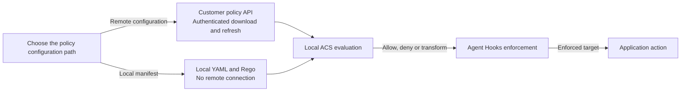

# Python remote policy polling

Unreleased checkout example: one tenant/policy selection per agent, startup
download, **five-minute default** background polling, and memory-only storage.
Any backend can implement the [v1 contract](../../docs/remote-policy-contract.md);
policy management stays outside the SDK.

This example does **not** call a model. Decisions use the real ACS Rego engine,
not mocked or scripted verdicts.

The refund-limit example uses `RefundPolicyHTTPServer` in [server.py](server.py)
as its local reference API.
It returns a v1 `application/json` envelope containing the YAML `manifest` and
inline Rego `bundles`, not separate YAML and Rego file responses. `PolicyServer`
owns its thread and publishes example policy revisions. This loopback-only
server does not implement production authentication.

## High-level architecture



These are alternative sources for the same application integration, not two
steps in a chain. Remote access uses a customer-owned signer or the optional
Azure adapter; evaluation stays local. The API is a separate trust boundary:
downloaded policy is validated, not trusted to configure authentication.
Change the path and reopen the control to switch sources. Local files have no
background refresh, and a remote outage never selects them automatically.
The [SDK architecture](../../sdk/remote-policy/python/README.md#high-level-architecture)
shows authentication and ownership.

## Same application setup for local and remote YAML

```python
from agent_control_spec import ActivatedPolicy, AsyncAcsInterceptor

policy = ActivatedPolicy.activate("policies.yaml")


async def serve(emitter):
    async with AsyncAcsInterceptor(policy) as control:
        emitter.register(control, control.name)
        # Emit host-owned contexts and use the enforced target.
```

For local manifests, activation performs the existing native preparation.
For `remote_policy` YAML it only captures validated configuration; async entry
fetches all initial valid policies and starts the default HTTP poller. The normal
`--remote` demo uses this flow. An explicit CLI polling-interval override retains
the advanced client path; normal managed scheduling comes from YAML.

Remote handles are single-owner/single-use: call `activate()` again for a new
lifetime, and use separate loaders/registries for concurrent lifetimes. Remote
evaluation has one process-wide slot/no queue, not local concurrency 8. Capacity
denies with `runtime_error:acs_async_capacity_exceeded`. Use async entry and close
on the same owner loop; synchronous remote evaluation/introspection is an error.
The final snapshot check occurs after the interceptor's last await, but does not
cover a later application or emitter await. Re-evaluate if execution is deferred.

Customers can pass `RemotePolicyFileLoader(registry=..., source_factory=...,
poller_factory=...)` as trusted `remote_loader=` to `activate`. Factories are
typed, bounded host constructors; auth stays independent of source/poller
selection. YAML only selects registered provider keys/options, never executable
imports. See the [custom-factory contract](../../sdk/remote-policy/python/README.md#custom-pollers-and-sources).
Azure remains an optional separate auth adapter.

## Run locally

Remote polling is a separate optional distribution,
`agent-control-spec-remote-policy`. The base `agent-control-spec` package neither
includes polling modules nor installs HTTP or cloud credential dependencies.
This distribution is unreleased; use the checkout. Build/install the native SDK
using its instructions, then from the repository root:

```powershell
python -m pip install -e .\sdk\remote-policy\python
```

The polling package depends on the base SDK for ACS validation. Customers who
do not need polling install only the base SDK. Run the example with:

```powershell
python -m examples.remote_policy.demo --local
```

On Windows with a Linux SDK build, run the command in the same WSL environment
and virtual environment used to build the extension. A Linux extension cannot
be loaded by Windows Python.

Local mode starts a loopback-only reference API on an ephemeral port, downloads
two policies, updates one, and proves the other agent stays independent. It
evaluates policies in a bounded child process. Nothing is paid or sent: an
allowed operation only appends to a local list.

Captured from a real checkout run:

```text
agent-1: revision=1 decision=allow
agent-1: revision=2 decision=deny; agent-2: revision=1 decision=allow
Executed inert refunds: 2; SDK interval=300s
```

Manual refresh keeps the demo short; the scheduler is tested separately.
`--poll-interval-seconds 5` explicitly shortens the local demo interval without
changing the SDK's 300-second default.

## Configure authentication

[policies.yaml](./policies.yaml) contains generic selectors, an example
endpoint, and `credential_ref: policy-reader`.
It has no provider-specific defaults, deployment identifiers or secrets.
Replace the endpoint and selections, then configure a registered credential.
Unconfigured HTTPS templates fail closed, not anonymously.

For a host-registered provider, name its registry key:

```yaml
remote_policy:
  credential_ref: policy-reader
  credentials:
    policy-reader:
      provider: custom_platform
      options: {}
```

Register `custom_platform` in trusted host code as shown under
[Custom providers](#custom-providers); it is a placeholder, not a built-in
provider. Keep the endpoint, agents and scheduling fields from the template.
The API owner supplies the authentication requirements and grants read access
for each selection. Authentication alone does not authorize a policy read.
The API must implement the public v1 contract; no existing service API is assumed.

```powershell
python -m examples.remote_policy.demo --remote --config .\examples\remote_policy\policies.yaml --watch-seconds 650
```

`--remote` uses YAML only. Do not combine it with provider-specific CLI arguments
or `POLICY_API_ENDPOINT`/`POLICY_API_SCOPE` overrides.

Remote demo mode evaluates each downloaded policy as an inert refund example.
Its watch keeps the scheduler alive and reports current revisions, not an
invented successful-refresh count. Use Ctrl+C to cancel and close.

### Optional Azure authentication

The optional Azure adapter can be explicitly selected instead of a custom
provider:

```yaml
remote_policy:
  credential_ref: policy-reader
  credentials:
    policy-reader:
      provider: azure_cli
      options:
        scope: api://YOUR-POLICY-API-APP-ID/.default
        process_timeout_seconds: 5
```

Keep the endpoint, agents and scheduling fields from the template. Install the
polling package's `azure` extra and sign into the CLI in the same OS environment as
Python. The `azure_cli` factory creates and closes `AzureCliCredential`.
No default credential chain or automatic sign-in is used.

```powershell
python -m pip install -e ".\sdk\remote-policy\python[azure]"
```

The `--azure` mode supports explicit `azure-cli`,
`managed-identity`, or `workload-identity` credential selection, with required
`--endpoint` and `--scope`. It warns that its explicit arguments take precedence.
Use `--remote` for configuration-selected credentials. Neither mode is deprecated.

## Use the SDK in your host

```python
from agent_control_spec_remote_policy import RemotePolicyClient
from agent_control_spec_remote_policy.poller import JsonValue


async def run_agent(context: dict[str, JsonValue]) -> None:
    async with RemotePolicyClient.open("remote-policies.yaml") as policies:
        verdict = await policies.evaluate("agent-1", "pre_tool_call", context)
        print(verdict.to_wire())
```

Keep that context open while the application serves agents.
The library owns YAML parsing, configured credentials, HTTP, polling, conditional
ETags, isolated native evaluation, freshness checks, and cleanup. Customers do
not copy the demo's refund helper or worker machinery. The YAML filename is
arbitrary and uses the same `remote_policy` schema as the templates.

The API must return the [standard v1 envelope](../../docs/remote-policy-contract.md#http-request-and-response)
with the manifest and inline bundles accepted by ACS; it does not require a
customer-written parser. Evaluation returns the existing agent-hooks `Verdict`.
Apply it inside the open context. Do not await between an allow and the protected
action; re-evaluate if execution is deferred. The client checks that the policy
is still current after evaluation and blocks stale results.

`PolicyPoller`, `HttpPolicySource`, and `PolicySource` remain advanced extension
points. Transport extensibility does not make arbitrary policy languages
executable or bypass the existing restricted ACS profile.

## Custom providers

Authentication and retrieval are independent. Trusted host code registers
credential factories; YAML names only a registered key, never an import or
command. An AWS signer or another platform can implement
`RequestAuthenticator.authenticate(request)` and return only new authentication
headers for the final immutable method, URL, headers and body.
There is no built-in AWS signer, S3/AppConfig source or verified AWS deployment.

An explicit registry is the complete allow-list, not merged with defaults.
A custom registry works without any cloud SDK dependencies unless its factory
requires them. Host registration has this shape:

```python
async def serve(config: PollerConfig, factory: CredentialProviderFactory) -> None:
    registry = CredentialProviderRegistry({"custom_platform": factory})
    async with RemotePolicyClient.open(config, registry=registry) as policies:
        for agent in config.agents:
            print(agent.agent_id, policies.get_policy(agent.agent_id).revision)
```

Here `PollerConfig` comes from `agent_control_spec_remote_policy.poller`;
`CredentialProviderFactory` and `CredentialProviderRegistry` come from
`agent_control_spec_remote_policy.auth`; `RemotePolicyClient` comes from
`agent_control_spec_remote_policy`. Configure the selected definition's
`provider: custom_platform` and non-secret scalar options under
`remote_policy.credentials`. Fetch secret values inside the trusted factory,
not from YAML. A factory is an async context manager yielding one credential.
`AuthorizationProvider.authorization()` is the single-header interface used
explicitly by `AzureAuthorizationProvider` and available to other token providers.
`RequestAuthenticator.authenticate(request)` supports request-dependent signing,
including AWS-style schemes. Both are accepted by the same `Credential` boundary;
a credential must implement exactly one interface. No built-in AWS signer is
included.

Before this extraction, unreleased checkout imports lived under
`agent_control_spec.remote_policy*`. Update them to the `poller`, `auth`, `http`
and `azure` modules of `agent_control_spec_remote_policy`; no compatibility
modules remain in the base package.

Providers cannot replace routing, framing, cookies, encoding, conditional or
correlation headers. See the [authentication contract](../../docs/remote-policy-contract.md#authentication-and-provider-configuration)
for exact bounds. Presigned URL mutation, cookie sessions and mutual-TLS
transport configuration are outside this interface.

Use one registry per source. Its owner task enters and exits the selected
factory in the same task, and closes it after the poller/source. Factory
`ContextVar` changes are not inherited by authentication calls: keep state on
the provider instance. Up to four calls can run concurrently. Credentials must
use bounded, cancellation-cooperative I/O without unowned workers.
Sources never close caller-injected credentials.

Entry and cleanup are bounded by request-timeout budgets. Failed cleanup is
surfaced; retained work is observed and a failed registry refuses reuse.
Cancellation during successful cleanup propagates after cleanup completes.
When cleanup itself fails, the original primary error remains primary with
safe notes.

The Azure binding caches one token per instance with synchronized refresh and
a 60-second expiry margin. A service 401/403 fences policy access but does not
clear that cache. Reopen a registry-owned provider, or recreate a host-injected
provider, after changing identity or credentials. This does not bypass the
CLI's cache or permission propagation. The CLI process budget must leave time
for HTTP inside the whole-fetch deadline.

Credential logs contain safe event/reason codes, known exception classes,
configuration labels and request IDs, never tokens, options or vendor messages.
Metadata is in `LogRecord` extra fields; use a structured handler to display it.

## Safety and first-slice limits

Downloaded does **not** mean compiled/prepared. The evaluation demo uses one
admitted single-shot child at a time: 10-second wall budget, 2 MiB input/output,
64 KiB stderr, isolated Python, an empty working directory and a restricted
environment. POSIX adds 1 GiB address-space and five-second CPU limits; Windows
has no Job Object memory limit here. Failure/cancellation kills and drains the
owned child. This is crash/time containment, **not a full OS sandbox** or a
production evaluator. The demo requires explicit allow/deny policies.

Before any effect, the host rechecks snapshot identity and expiry.
Authorization failures, stale policies, engine errors or changed snapshots
block. A 304 cannot renew a lease. Complete details are in the
[contract](../../docs/remote-policy-contract.md).

Not implemented: inheritance resolution, mixed policy formats, disk
persistence, policy writes or automatic interceptor hot-swapping.
