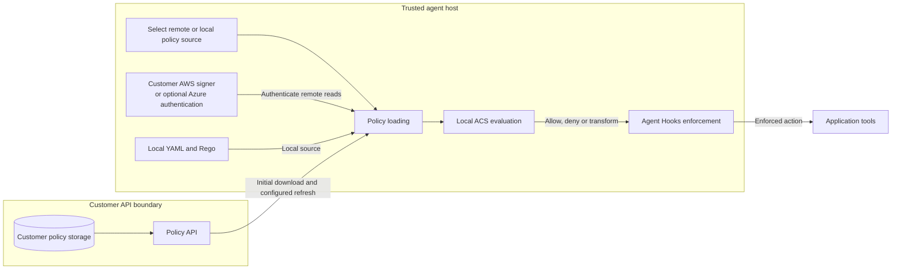

<!-- Copyright (c) Microsoft. All rights reserved. -->

# Remote policy polling for Agent Control Specification

`agent-control-spec-remote-policy` is the optional, pure-Python remote polling
distribution. Its import namespace is `agent_control_spec_remote_policy`.
The native `agent-control-spec` distribution remains the local policy evaluator:
installing it alone does not install HTTP, YAML, Azure, or polling code.

The source lives under `sdk/remote-policy/python`, leaving room for future
language implementations alongside it. It builds a separate PyPI distribution,
`agent-control-spec-remote-policy`; the directory layout does not change the
distribution name or the `agent_control_spec_remote_policy` import namespace.

## High-level architecture



Remote storage changes where policies come from, not where they are evaluated.
The host selects either authenticated remote downloads or local YAML/Rego.
Remote responses are validated before use; credentials stay out of policy input.
Switching sources means changing the configured path and reopening the control,
not automatic fallback on a remote failure. The host remains responsible for
using the enforced result before running a tool.

## Install

This checkout defines version **0.4.0b1**; the extraction is not a claim that
this distribution has been published. Until release, install from this checkout
or from locally built wheels:

```sh
python -m pip install ./sdk/python ./sdk/remote-policy/python
# Only when using the Azure adapter:
python -m pip install ./sdk/python "./sdk/remote-policy/python[azure]"
```

Run these commands from the repository root. Python 3.11 or later is required;
building the native dependency from source also requires its Rust build tools.
Once published, the corresponding distribution requirement is
`agent-control-spec-remote-policy==0.4.0b1` (or its `[azure]` extra).
The optional package requires `agent-control-spec>=0.4.0b1,<0.5`,
`httpx>=0.28.1,<0.29`, and `PyYAML>=6.0.3,<7`. The Azure extra adds
`azure-identity>=1.25.3,<2` and `aiohttp>=3.14.4,<4`.

## Use and ownership

The normal entry point is the same core activation API used for local manifests.
Synchronous `activate` captures validated configuration only; async interceptor
entry opens credentials, creates the default HTTP source and poller, fetches
all initial valid policies, and starts scheduling. No synchronous networking,
event-loop bridge, native-handle swapping or disk snapshot cache is used.
The service must implement the existing [v1 response contract](../../../docs/remote-policy-contract.md#http-request-and-response):
an ACS manifest and its inline Rego bundles, not a deployment-specific payload.

```python
from agent_control_spec import ActivatedPolicy, AsyncAcsInterceptor

policy = ActivatedPolicy.activate("policies.yaml")


async def serve(emitter) -> None:
    async with AsyncAcsInterceptor(policy) as control:
        emitter.register(control, control.name)
        # Emit host-owned contexts and consume the emitter's enforced target.
```

Keep the context open for the application's lifetime, not once per operation.
Pass the existing host-owned agent-hooks context and apply the native ACS
`Verdict` (`allow`, `deny`, or `transform`); the SDK does not execute actions.
Do not await between an allow and its protected action. If execution is deferred,
re-evaluate. The library checks the current policy before **and after** isolated
evaluation. A snapshot-bound completion carries that gate across the backend task;
the outer interceptor checks after its final internal await. Expiry, replacement,
authorization fences, or closure block the result.
Native engine errors remain fail-closed deny verdicts with `runtime_error:*` reasons.

An activation is single-owner/single-use, even if its interceptor is closed
without entering. Call `activate()` again for a new lifetime. Use separate loaders
and credential registries for concurrent lifetimes. Remote evaluation has one
process-wide slot and no queue, unlike local mode's default concurrency of 8.
Every overlapping call, for another agent or another interceptor, returns
`runtime_error:acs_async_capacity_exceeded`, and the warning log names the agent.
Each evaluation starts a fresh isolated child process: on a Linux developer laptop
with the sample policy the median was about 0.29 seconds, so the ceiling is
roughly 3 to 4 evaluations per second per process. Measure your own host and
policy. Remote mode requires strict
scope and rejects non-default local admission options/native dispatchers or
telemetry it cannot honor. Synchronous remote evaluation/introspection raises
`ManagedPolicyUsageError`; pre-READY use is an error, while closing/closed use
denies. Closing a pending call returns a closed deny unless its caller itself
requested cancellation. Failed snapshot freshness remains a typed unavailable
failure, converted to a fail-closed host error by the emitter.
A failed startup remains a pre-READY usage error rather than a reusable closed
interceptor; create a fresh activation for another attempt.
Closing while entry is still starting raises `ManagedPolicyUsageError`, not
`CancelledError`, unless the entry caller itself requested cancellation.
The managed outer startup wait is 240 seconds; close waits up to 30 seconds for
its loader owner, after a separate evaluation-drain phase of up to 30 seconds.
These fixed limits are independent of YAML/credential budgets
and can expire before a legal inner cleanup budget. Deadline exhaustion raises
`ManagedPolicyUsageError` and may leave bounded work retained: keep the owner loop
running until that work actually drains. Repeated `aclose()` calls reuse owned
cleanup and replay recorded failures, including startup failures; they do not
silently turn failed cleanup into success.

This final check does not make a later emitter/application await atomic with the
effect. Re-evaluate if execution is deferred or a later interceptor awaits.

The YAML uses the existing `remote_policy` schema; the filename is not fixed.
Configure a provider that trusted host code has registered, such as the optional
`azure_cli` adapter. The default credential registry is empty: a `credential_ref`
is refused unless the host registered the provider its YAML names, so a YAML file
alone never selects a credential factory. Register providers with
`RemotePolicyFileLoader(registry=CredentialProviderRegistry(factories))` or
`RemotePolicyClient.open(path, registry=CredentialProviderRegistry(factories))`;
YAML never imports or executes provider code. No AWS signer is bundled.
Whoever can write the YAML controls the options a registered factory receives
(the Azure CLI factory's token `scope`) and the `endpoint` that receives the
resulting credential, so treat it as trusted host configuration.
The native base SDK still has no dependency on this optional client.

The existing `RemotePolicyClient.open(path)` remains supported: its
`evaluate(agent_id, point, context)` still returns the full native `Verdict`.
Its `open` also accepts a validated `PollerConfig`, or caller-owned credentials through
`credentials=...` (mutually exclusive with `registry`). The client closes its
poller/source before registry-owned credentials. Injected credentials remain
caller-owned. `get_policy`, `status`, `refresh`, and `assert_current` remain
available for advanced integrations. `PolicyPoller`, `HttpPolicySource`, and
`evaluate_policy_snapshot` remain lower-level building blocks; the snapshot
evaluator alone does not perform the final current-policy gate.
Cancellation arriving during startup or teardown still waits for bounded
poller/source shutdown before closing registry-owned credentials.

Evaluation runs in a library-owned subprocess, not an example script. It receives
only the validated artifacts and host-supplied intervention point/context, never
ambient credential variables. Admission is one worker per host process with no
queue. Calls default to ten seconds and accept a maximum thirty-second budget.
Worker cleanup has a separate five-second limit; retained work raises a cleanup
error and keeps admission occupied until the process exits.
Input/output and native execution are bounded; timeout/cancellation kills and
drains the child, retaining admission until it actually exits. This isolated
single-shot path prioritizes safety over compilation caching or throughput.
Do not suppress cleanup failures or treat caller timeout as proof work stopped.

On Linux the worker's address-space cap is 1 GiB. On macOS it is 1 GiB above
the process's existing virtual mappings, which include large runtime reservations.
The macOS measurement uses the fixed system `ps` command with a one-second
timeout. Missing/invalid measurements or failed limit setup stop evaluation;
there is no unlimited fallback. POSIX CPU limits are five seconds soft and six
seconds hard, and stricter inherited memory/CPU limits are never raised.
Windows does not expose POSIX resource limits; the parent deadline, bounded
input/output, worker admission, and native execution limits still apply.
This subprocess is not a replacement for an OS/container security sandbox.
Completed responses with nonzero worker exits log a fixed `failure_code`
(`resource_limit_failed`, `evaluation_failed`, or `unknown`) and the `exit_code`;
raw worker output and policy/context data are never included in that diagnostic.

### Custom pollers and sources

Pass trusted host code, not YAML imports:

```python
from agent_control_spec import ActivatedPolicy
from agent_control_spec_remote_policy import (
    RemotePolicyFileLoader,
    PolicyPollerFactory,
    PolicySourceFactory,
)


def configure(
    path: str,
    source_factory: PolicySourceFactory,
    poller_factory: PolicyPollerFactory,
    registry,
):
    loader = RemotePolicyFileLoader(
        registry=registry,
        source_factory=source_factory,
        poller_factory=poller_factory,
    )
    return ActivatedPolicy.activate(path, remote_loader=loader)
```

`PolicySourceFactory` receives validated `PollerConfig` and a read-only credential
mapping. `PolicyPollerFactory` receives that config and its owned `PolicySource`
and returns `PolicyPollerProtocol`: `config`, async `start`, `refresh`, `aclose`,
and synchronous `get_policy`, `status`, `assert_current`. Constructors must be
bounded/nonblocking. Capture additional host configuration in typed factory
instances; no schema changes or plugin strings are needed.
`endpoint` is optional; if present it must be an HTTP(S) URL without user-info,
query or fragment, even when a custom source does not use HTTP.

Custom pollers must preserve existing strict artifact validation, atomic immutable
snapshots, fixed leases, authorization fences, bounded work and source ownership.
Use composition/subclassing of `PolicyPoller` when possible. These hooks trust
host code; they are not a sandbox for downloaded code. Authentication is separate:
use existing token providers/signers, the default HTTP implementation, a custom
source, or the optional Azure adapter independently.

If poller construction fails, source close has a five-second default phase.
A timed-out source keeps its registry-owned credentials alive in one retained
cleanup owner until its users/close drain; startup raises `PolicyCloseError`
with a retained count. Do not reuse that registry or close the owner loop early.
Injected credentials remain caller-owned, including after cleanup failure.

### Managed integration compatibility and release gate

Managed activation requires `MANAGED_ACTIVATION_API_VERSION == 1` in both core
and optional distributions. The optional managed export is lazy: ordinary package,
star, poller, auth, source, client and evaluator imports remain supported with an
older core exposing the existing low-level APIs. `RemotePolicyFileLoader` is
included in `__all__` only when the core has this capability. Explicit managed
lookup/import on old core raises an actionable `PolicyUsageError`.
`hasattr(package, "RemotePolicyFileLoader")` deliberately raises the same error
on an unsupported core, rather than returning `False`; discovery should check
the core capability or `__all__` instead. New core with an old optional package
rejects valid remote YAML with `RemotePolicyDependencyError`; local behavior stays local.
Missing optional install preserves the native parser error with an install hint.
Recognized invalid remote roots preserve the native error type with a safe
`code=config; path=remote_policy` diagnostic, not configuration contents.

The polling package requires the core release it is published with, which is the
first release that carries capability 1. A core published earlier does not, so
`0.4.0b1` metadata is not proof an archive has that capability. The release
checklist is in [RELEASING.md](../../../RELEASING.md).

### Reusable credential interfaces

Both shapes are supported, with distinct purposes:

* `AuthorizationProvider.authorization() -> str` is an async **single-header**
  protocol: it supplies a validated `Authorization` value, such as a bearer token.
  `AzureAuthorizationProvider(AuthorizationProvider)` is the Azure implementation;
  its explicit scope, serialized refresh, bounded token cache, failure behavior,
  and cancellation semantics remain unchanged.
* `RequestAuthenticator.authenticate(AuthenticationRequest) -> Mapping[str, str]`
  is an async **request-aware** protocol for signing the final request.
  The immutable request view includes method, URL, headers, and body. The
  adapter validates returned add-only authentication headers and rejects
  reserved-field overwrites. This shape can support host-supplied AWS-style
  signers, but this package includes **no AWS signer** and makes no claim of
  verified AWS deployment.

`Credential` is the union accepted by the shared HTTP adapter and registry.
A credential implementing **both** protocols is ambiguous and rejected before
transport use. Custom providers use the same registry and source as Azure.
The tests exercise non-Azure single-header providers and deterministic HMAC
signing; the HMAC test double is not an AWS implementation.

### Customer-owned signer, Azure, and switching back to local files

The same host setup supports a customer-owned request signer and the optional
Azure adapter. The default registry is empty and an explicit registry is the
complete allow-list, so register every provider key the YAML may name, including
the Azure factories when you want them:

```python
from agent_control_spec import ActivatedPolicy
from agent_control_spec_remote_policy import RemotePolicyFileLoader
from agent_control_spec_remote_policy.auth import (
    CredentialProviderFactory,
    CredentialProviderRegistry,
)
from agent_control_spec_remote_policy.azure import azure_credential_factories


def load_policy(
    path: str, customer_signer_factory: CredentialProviderFactory
) -> ActivatedPolicy:
    registry = CredentialProviderRegistry(
        {**azure_credential_factories(), "customer_aws": customer_signer_factory}
    )
    loader = RemotePolicyFileLoader(registry=registry)
    return ActivatedPolicy.activate(path, remote_loader=loader)
```

The customer's async context-manager factory receives non-secret options and
yields a `RequestAuthenticator`. It owns credential acquisition, rotation and
cleanup. For AWS IAM authentication, use a customer-maintained SigV4 signer;
ACS does not implement or verify AWS signing itself. Return only newly added
authentication headers, such as `Authorization`, `X-Amz-Date` and
`X-Amz-Security-Token`, not a copy of all signed request headers. `Host` and
existing headers must remain unchanged. Sign every request, including conditional
refreshes. Blocking AWS credential discovery/refresh must not run on the event
loop or escape the bounded ownership contract.

Configure remote downloads in a file such as `remote-policy.yaml`:

```yaml
remote_policy:
  endpoint: https://policies.example.net
  credential_ref: policy-reader
  credentials:
    policy-reader:
      provider: customer_aws
      options:
        region: us-east-1
        service: execute-api
  poll_interval_seconds: 300
  request_timeout_seconds: 10
  agents:
    - agent_id: agent-1
      tenant_id: tenant-1
      policy_id: policy-1
```

With these settings the policy service must publish a greater revision no later
than `lease - 2 * poll_interval - request_timeout` after the previous one, even
when the policy has not changed (290 seconds for a 900-second lease), and a `304`
never extends a lease. The
[contract](../../../docs/remote-policy-contract.md#freshness-failures-and-ownership)
is the normative source.

`customer_aws`, `region` and `service` are a host-defined factory contract, not
built-in AWS configuration. For Azure, change the selected definition to
`provider: azure_cli` with `scope` and optional `process_timeout_seconds`, as
shown in the [authentication contract](../../../docs/remote-policy-contract.md#optional-azure-credential-adapter).
Only the selected factory is opened. Install the `[azure]` extra when using Azure;
registering its factory alone does not import Azure SDKs.

Keep the existing `async with AsyncAcsInterceptor(policy)` application flow.
Async entry downloads the initial policy and starts the configured scheduler;
evaluation uses the validated in-memory manifest/Rego locally, not a remote
evaluation API. Your API must serve the
[v1 artifact envelope](../../../docs/remote-policy-contract.md#http-request-and-response),
not a bare YAML file or a provider-specific response. Use a custom `PolicySource`
if the API cannot expose that contract.

To switch back, change only the path supplied to `load_policy`, from
`remote-policy.yaml` to a local ACS manifest such as
[`limits.yaml`](../../../examples/python_composition/limits.yaml). Its
`bundle: ./policy/limits.rego` resolves relative to that manifest. The same
loader/registry can stay in host setup: local activation never opens credentials,
the HTTP source or the poller. Close the previous interceptor and activate the
new path; switching is not live mutation of an existing activation.
Local policies are prepared once and do not inherit remote background polling;
reactivate explicitly to pick up local file changes. Remote outages do not
automatically select local files: expiry or authorization loss stays fail-closed.

The integration tests cover both a customer-owned signing test double and the
real Azure adapter with a fake credential: configured startup, a five-second
scheduled revision update, real local Rego evaluation through agent-hooks,
path-only local switching and cleanup. This verifies the extension contract,
not AWS IAM signature compatibility or live Azure/AWS authorization.

`azure_credential_factories()` supplies the explicit `azure_cli` factory; nothing
registers it for you. Importing the package or registering the factory does not
import Azure SDKs until Azure credential acquisition is needed. Azure SDKs are
optional, not a fallback for custom providers.

## Development and isolation checks

From the repository root, after installing the parent-managed development lock
and both packages into a development environment:

```sh
ruff format --check sdk/remote-policy/python
ruff check sdk/remote-policy/python
pyright --project sdk/remote-policy/python
pytest -c sdk/remote-policy/python/pyproject.toml sdk/python/tests sdk/remote-policy/python/tests_remote_policy
```

The strict type project covers production code, all moved tests, and the
parent-owned remote-policy examples. Test helpers and the JSON fixture stay in
`sdk/remote-policy/python/tests_remote_policy`; tests resolve the fixture beside their source,
so the optional package itself can be imported from an installed wheel. Tests
and examples require a checkout and are intentionally not shipped in the wheel.
The distinct test-package name avoids collisions with the core SDK's `tests`
package when both suites run together.

Build separately, with an output directory outside either source tree:

```sh
python -m build --wheel --outdir dist/native sdk/python
python -m build --outdir dist/remote-policy sdk/remote-policy/python
```

The pure-Python build backend is pinned to `setuptools==84.0.0`. Inspect both
wheels and source archive with the packaging tests by setting `ACS_CORE_WHEEL`,
`ACS_REMOTE_POLICY_WHEEL`, and `ACS_REMOTE_POLICY_SDIST` to their exact paths, then running
`pytest -c sdk/remote-policy/python/pyproject.toml sdk/remote-policy/python/tests_remote_policy/test_packaging.py`.
Without those variables, archive checks are explicitly skipped; installed
metadata and checkout-boundary checks still run.
Release assurance must also set `ACS_REQUIRE_PACKAGE_ARTIFACTS=1` so missing
artifact paths fail instead of being skipped.

For full isolation, use two fresh environments: install only the native wheel in
one and confirm it has no remote/cloud requirements or `remote_policy*` modules;
install the native and optional wheels in the other, run `python -m pip check`,
import the facade without Azure installed, and run the checkout tests.
Add the Azure extra only for Azure-specific coverage. Do not interpret an
editable install or a shared development environment as proof of wheel isolation.
